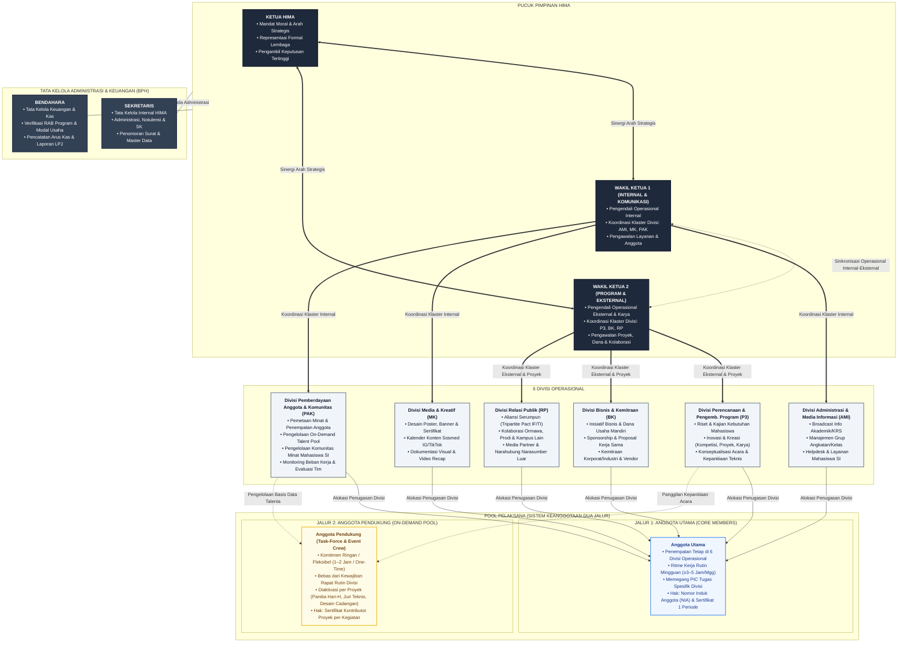
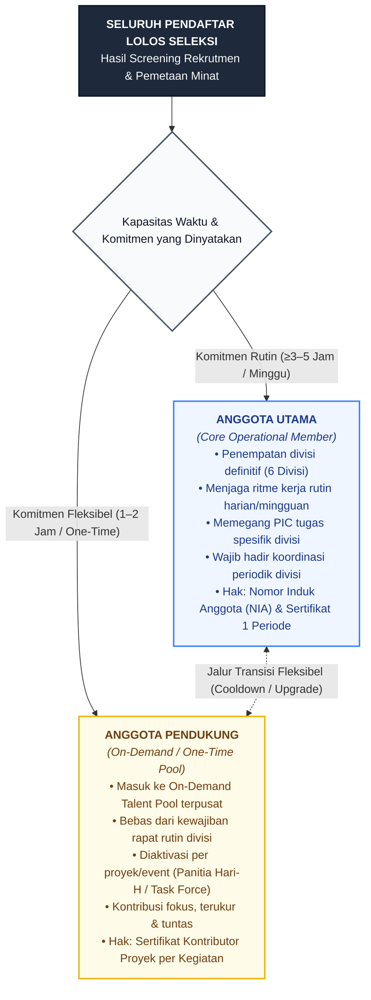
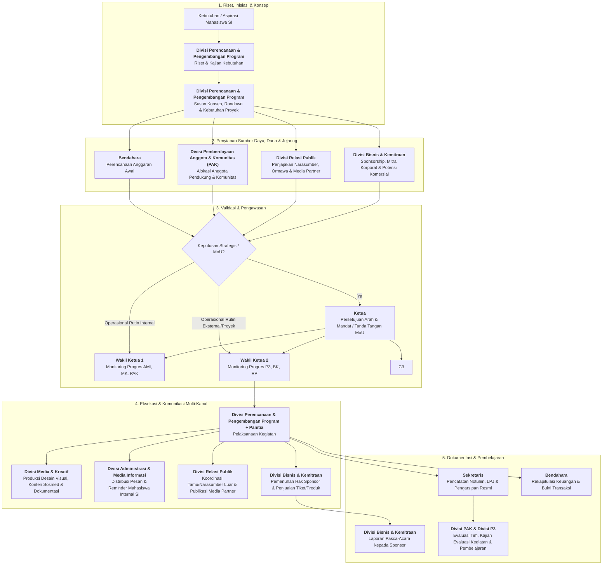

# Struktur dan Peran HIMA

## 1. Tujuan

Dokumen ini menetapkan rancangan struktur kerja HIMA yang ramping, berbasis fungsi, dan dapat dijalankan dengan kapasitas anggota yang masih berkembang.

Rancangan ini disusun untuk menjawab masalah yang teridentifikasi pada diagnosis awal: komunikasi tidak berjalan konsisten, publikasi tidak aktif, organisasi cenderung reaktif, tugas tidak memiliki pemilik yang jelas, serta anggota belum terkelola dan terlibat secara terarah.

Dokumen ini menetapkan fungsi dan batas tanggung jawab. Penempatan nama personel, jumlah anggota per divisi, dan prosedur operasional rinci ditetapkan pada dokumen terpisah.

## 2. Prinsip Struktur

- Fungsi lebih penting daripada banyaknya jabatan.
- Tidak ada fungsi kritis yang boleh kosong hanya karena belum ada divisi besar.
- Struktur harus ramping dan dapat dijalankan oleh anggota yang tersedia.
- Perangkapan fungsi diperbolehkan sementara, tetapi tanggung jawab tetap harus jelas.
- Setiap pekerjaan harus memiliki pemilik, keluaran, dan jalur eskalasi.
- Pengurus inti (Ketua, Wakil Ketua 1, Wakil Ketua 2, Sekretaris, Bendahara) menjaga mandat, koordinasi, administrasi, dan keuangan.
- Divisi menjaga fungsi operasional organisasi.
- Anggota operasional ditempatkan pada divisi atau proyek berdasarkan kebutuhan, kapasitas, dan minat.
- Program tidak berdiri sebagai divisi tersendiri. Perencanaan hingga pelaksanaan program, termasuk riset, inovasi, dan kreasi, merupakan mandat Divisi Perencanaan & Pengembangan Program dengan dukungan divisi lain dan anggota operasional.
- Segala bentuk kerja sama yang melibatkan aliran dana atau nilai komersial (bisnis, dana usaha, sponsorship, vendor, kemitraan korporat) dipegang oleh Divisi Bisnis & Kemitraan. Hubungan non-komersial dengan pihak luar dipegang oleh Divisi Relasi Publik.

## 3. Bentuk Struktur

### Ringkasan Tingkatan Struktur:

- **Pengurus Inti (BPH)**: Ketua, Wakil Ketua 1, Wakil Ketua 2, Sekretaris, Bendahara
- **Klaster Koordinasi Operasional**:
  - **Klaster Internal & Komunikasi (Wakil Ketua 1)**: Divisi AMI, Divisi MK, Divisi PAK
  - **Klaster Program, Bisnis & Relasi (Wakil Ketua 2)**: Divisi P3, Divisi BK, Divisi RP
- **Divisi Operasional (6 Divisi)**:
  - Divisi Administrasi & Media Informasi (AMI)
  - Divisi Media & Kreatif (MK)
  - Divisi Perencanaan & Pengembangan Program (P3)
  - Divisi Pemberdayaan Anggota & Komunitas (PAK)
  - Divisi Bisnis & Kemitraan (BK)
  - Divisi Relasi Publik (RP)
- **Pool Pelaksana (Dua Jalur Keanggotaan)**:
  - **Anggota Utama**: Penempatan divisi tetap, ritme rutin harian/mingguan (≥3 jam/minggu), memegang PIC fungsi
  - **Anggota Pendukung**: Pool on-demand / task-force, kontribusi per-proyek, insidental, atau one-time (1–2 jam/minggu atau ad-hoc)

Kelima pengurus inti bekerja sebagai satu kepengurusan terpimpin.

> [!NOTE]
> **Catatan Ketersediaan SDM (Opsi Wakil Tunggal):**
> Skema 2 Wakil Ketua adalah struktur ideal berbasis klaster. Namun, **apabila ketersediaan SDM/personel tidak memungkinkan atau masih terbatas**, maka jabatan Wakil Ketua **hanya ada 1 (satu)**. Dalam kondisi ini, Wakil Ketua tunggal mengoordinasikan seluruh 6 divisi operasional secara langsung dengan memprioritaskan fungsi-fungsi paling krusial.

Kepala divisi bertanggung jawab kepada Ketua dan Wakil Ketua pembina klasternya (atau Wakil Ketua tunggal jika SDM terbatas) sesuai jalur koordinasi yang ditetapkan. Anggota operasional bertanggung jawab kepada kepala divisi atau koordinator proyek yang menugaskannya.

## 4. Pengurus Inti

### Ketua

**Mandat:** Memegang arah, mandat organisasi, keputusan strategis, dan representasi formal HIMA.

**Tanggung jawab:**

- Menjaga agar kegiatan dan keputusan selaras dengan mandat HIMA.
- Mengambil keputusan strategis dan menyelesaikan isu yang tidak dapat diputuskan pada tingkat divisi.
- Menjadi representasi formal HIMA kepada Program Studi, kampus, organisasi lain, dan mitra strategis.
- Menyetujui arah program, prioritas, serta keputusan penting organisasi.
- Memastikan akuntabilitas akhir atas kinerja kepengurusan.

**Bukan mandat utama:**

- Mengerjakan seluruh tugas operasional.
- Menjadi satu-satunya penghubung komunikasi.
- Menggantikan fungsi kepala divisi.

### Wakil Ketua 1 (Bidang Internal, Komunikasi & Keanggotaan)

**Mandat:** Mengendalikan operasional organisasi ke dalam, mengoordinasikan arus informasi sivitas, identitas publikasi visual, serta tata kelola anggota dan komunitas.

**Klaster Divisi yang Dibawahi:**

1. **Divisi Administrasi & Media Informasi (AMI)**
2. **Divisi Media & Kreatif (MK)**
3. **Divisi Pemberdayaan Anggota & Komunitas (PAK)**

**Tanggung jawab:**

- Mengoordinasikan kerja harian dan mingguan Divisi AMI, MK, dan PAK agar informasi sivitas lancar, media sosial aktif, dan anggota terkelola dengan baik.
- Memastikan keselarasan antara publikasi visual (MK) dengan diseminasi informasi ke grup mahasiswa SI (AMI).
- Mengawal program keterlibatan anggota dan dinamika komunitas minat bersama Divisi PAK.
- Menyelesaikan hambatan operasional di tingkat klaster internal dan melaporkan progresnya secara berkala kepada Ketua.
- Menjadi pelaksana tugas Ketua apabila Ketua berhalangan pada ranah internal organisasi.

**Bukan mandat utama:**

- Mengambil alih tugas teknis kepala divisi AMI, MK, atau PAK.
- Mengintervensi negosiasi sponsor atau hubungan ormawa eksternal tanpa koordinasi dengan Wakil Ketua 2.

---

### Wakil Ketua 2 (Bidang Program, Bisnis & Relasi Eksternal)

**Mandat:** Mengendalikan operasional program kerja nyata, riset & kreasi, inisiatif bisnis/sponsorship, serta diplomasi jejaring eksternal organisasi.

**Klaster Divisi yang Dibawahi:**

1. **Divisi Perencanaan & Pengembangan Program (P3)**
2. **Divisi Bisnis & Kemitraan (BK)**
3. **Divisi Relasi Publik (RP)**

**Tanggung jawab:**

- Mengoordinasikan pelaksanaan program kerja, pilar riset/inovasi/kreasi (P3), pencarian sponsor/dana usaha (BK), dan relasi ormawa/mitra (RP).
- Mengawal eksekusi proyek unggulan (seperti _HIMSISFO Web Innovation Challenge_, website resmi, dan program kompetisi).
- Memastikan integrasi antara perencanaan program (P3), kebutuhan pendanaan/sponsor (BK), dan pemenuhan narasumber/media partner luar (RP).
- Menyelesaikan hambatan di tingkat klaster program/eksternal dan melaporkan progresnya secara berkala kepada Ketua.
- Mewakili Ketua dalam forum eksternal atau penjajakan kemitraan strategis apabila Ketua berhalangan.

**Bukan mandat utama:**

- Mengambil alih tugas teknis kepala divisi P3, BK, atau RP.
- Mengurus teknis broadcast grup kelas atau urusan internal keanggotaan (ranah Wakil Ketua 1).

> [!IMPORTANT]
> **Ketentuan Kontinjensi (Wakil Tunggal):**
> Jika kapasitas dan ketersediaan SDM pengurus tidak memungkinkan untuk mengisi dua posisi wakil, mandat Wakil Ketua 1 dan Wakil Ketua 2 digabung kembali menjadi **Wakil Ketua Tunggal**. Wakil Ketua tunggal bertindak sebagai pengendali operasional umum bagi seluruh 6 divisi, dibantu secara aktif oleh para kepala divisi.

### Sekretaris

**Mandat:** Memegang administrasi, memori organisasi, dan kebenaran dokumentasi resmi **internal HIMA**.

**Fokus Wilayah Kerja:** **Internal HIMA** (Pengurus, struktur internal, dan keanggotaan organisasi).

**Tanggung jawab:**

- Mengelola struktur kepengurusan internal, status keanggotaan aktif, dan data kontak kerja pengurus.
- Menyusun dan menyimpan notulen rapat inti/pleno, surat keputusan internal, agenda kerja, serta arsip resmi organisasi.
- Menjaga repositori terpusat (Google Drive / GitHub) agar dokumen internal organisasi terstruktur dan mudah diakses.
- Mencatat keputusan rapat, penugasan penting (_action items_), dan perubahan struktural organisasi.
- Mengelola sistem penomoran surat resmi dan persuratan formal kelembagaan (bekerja sama dengan Divisi RP dan Divisi BK untuk surat keluar eksternal, proposal, dan MoU).
- Mendukung kebutuhan tertib administrasi kepengurusan HIMA.

**Bukan mandat utama:**

- Membuat desain visual atau materi publikasi (milik Divisi Media & Kreatif).
- Menjadi admin penyebar pengumuman atau pengelola grup mahasiswa Sistem Informasi (milik Divisi AMI).
- Menginisiasi komunikasi diplomasi dengan pihak luar HIMA/luar SI (milik Divisi RP) atau negosiasi sponsor/bisnis (milik Divisi BK).

### Bendahara

**Mandat:** Memegang tata kelola keuangan dan kebenaran catatan finansial organisasi.

**Tanggung jawab:**

- Mengelola kas, anggaran, pemasukan, pengeluaran, dan bukti transaksi.
- Menyiapkan perencanaan anggaran untuk kegiatan bersama Divisi Perencanaan & Pengembangan Program dan pihak terkait.
- Memverifikasi modal usaha, mencatat pendapatan dana usaha, dan dana sponsorship yang dihimpun Divisi Bisnis & Kemitraan.
- Menyimpan catatan keuangan serta menyusun laporan keuangan periodik.
- Memberikan informasi kondisi anggaran untuk mendukung keputusan organisasi.
- Menjaga penggunaan dana tetap dapat dipertanggungjawabkan.

**Bukan mandat utama:**

- Memutuskan sendiri prioritas program.
- Menanggung biaya tanpa persetujuan yang berlaku.
- Mencari sponsor atau menjalankan usaha (milik Divisi BK).

## 5. Divisi Operasional

### 5.1 Ringkasan Mandat Tiap Divisi

| Divisi                                      | Fokus Wilayah Kerja                               | Fungsi Inti                                                                                                     | Bentuk Kerja Nyata                                                                                                                                            |
| ------------------------------------------- | ------------------------------------------------- | --------------------------------------------------------------------------------------------------------------- | ------------------------------------------------------------------------------------------------------------------------------------------------------------- |
| **Administrasi & Media Informasi (AMI)**    | **Internal Mahasiswa / Civitas SI**               | Memastikan informasi akademik & kemahasiswaan sampai, jelas, dan interaktif                                     | Distribusi broadcast info, reminder tenggat akademik/KRS, pengelolaan kanal/grup kelas SI, helpdesk pertanyaan mahasiswa SI                                   |
| **Media & Kreatif (MK)**                    | Publikasi Visual HIMA                             | Membentuk wajah, estetika visual, dan jejak digital publik HIMA                                                 | Desain sertifikat, poster, banner materi publikasi, _social media content_, dokumentasi visual, ucapan hari besar                                             |
| **Perencanaan & Pengembangan Program (P3)** | Program, Riset, Inovasi & Kreasi                  | Mengubah ide, kebutuhan, dan hasil kajian menjadi kegiatan, inovasi, dan karya nyata yang terukur               | Riset kebutuhan mahasiswa, kajian tren teknologi, kompetisi inovasi, proyek teknologi, showcase karya, konsep & rundown kegiatan, evaluasi acara              |
| **Pemberdayaan Anggota & Komunitas (PAK)**  | Personel, Anggota HIMA & Komunitas Mahasiswa SI   | Mengelola kapasitas, penempatan, kesehatan kerja anggota, serta komunitas minat mahasiswa SI                    | _Role matching_, alokasi penugasan, monitoring keaktifan (_workload balance_), pembinaan komunitas minat (coding, security, data, UI/UX), apresiasi tim       |
| **Bisnis & Kemitraan (BK)**                 | **Bisnis, Dana Usaha & Kemitraan Komersial**      | Membangun sumber pendanaan mandiri organisasi melalui usaha dan kerja sama bernilai komersial                   | Merchandise & produk digital, program bertiket bersama P3, proposal & negosiasi sponsorship, kerja sama korporat/industri, negosiasi vendor                   |
| **Relasi Publik (RP)**                      | **Eksternal SI & Eksternal HIMA (Non-Komersial)** | Membangun dan merawat hubungan serta reputasi HIMA dengan ormawa, prodi lain, kampus luar, dan publik eksternal | Penjajakan _Tripartite Pact_ (HIMA IF & TI), kolaborasi antar-himpunan, BEM/DPM, _media partner_, komunikasi narasumber luar, representasi di forum eksternal |

---

### 5.2 Divisi Administrasi & Media Informasi (AMI)

**Mandat:** Memastikan arus informasi akademik, kemahasiswaan, dan layanan organisasi sampai secara cepat, akurat, dan interaktif kepada seluruh mahasiswa Sistem Informasi UNSIA.

**Fokus Wilayah Kerja:** **Internal Mahasiswa / Civitas Sistem Informasi** (Mahasiswa aktif SI, grup angkatan, grup mata kuliah, dan perwakilan kelas SI).

**Tanggung jawab:**

- Menyebarkan pengumuman, broadcast info akademik/prodi, reminder tenggat (KRS, pembayaran, jadwal kuliah/ujian), dan informasi kegiatan melalui kanal resmi mahasiswa SI.
- Mengelola grup atau kanal komunikasi komunitas mahasiswa SI (Grup Angkatan WhatsApp/Telegram, direktori grup kelas).
- Mengelola layanan pertanyaan/aspirasi mahasiswa SI (_helpdesk_ tanya-jawab) dan meneruskannya ke pengurus inti atau pihak prodi jika memerlukan kebijakan khusus.
- Memastikan format pesan diseminasi informasi selalu memuat tujuan, sasaran, tindakan (_call-to-action_), tenggat waktu, dan kontak penanggung jawab yang valid.
- Menjalankan follow-up informasi penting ke ketua angkatan / komti kelas SI agar tidak ada mahasiswa yang tertinggal informasi.
- Membantu Divisi P3 menyebarkan survei/kuesioner riset kebutuhan mahasiswa SI dan Divisi BK menyebarkan info pre-order produk HIMA.

**Batas peran:**

- **Bukan urusan internal pengurus HIMA:** Administrasi kepengurusan, notulensi rapat pleno, SK kepengurusan, dan master data pengurus dikelola oleh **Sekretaris**.
- **Bukan urusan pihak luar prodi/kampus:** Komunikasi dengan himpunan prodi lain, kampus luar, dan narasumber ditangani oleh **Divisi Relasi Publik**; komunikasi dengan sponsor, vendor, dan mitra korporat ditangani oleh **Divisi Bisnis & Kemitraan**.
- **Bukan produksi desain grafis:** Materi publikasi visual dan poster diproduksi oleh **Divisi Media & Kreatif** (AMI bertindak sebagai penyalur/distributor pesan).
- **Bukan pengelola grup komunitas minat:** Grup komunitas minat/keahlian (misal komunitas coding atau security) dibina oleh **Divisi PAK**; AMI memegang grup angkatan dan kelas.

### 5.3 Divisi Media & Kreatif (MK)

**Mandat:** Membentuk wajah, estetika publik, dan jejak digital HIMA melalui pengelolaan **seluruh media sosial resmi**, produksi konten kreatif, publikasi visual, serta dokumentasi media.

**Fokus Wilayah Kerja:** **Media Sosial Publik & Identitas Visual HIMA** (Instagram `@himsisfo.unsia`, TikTok, YouTube Shorts, LinkedIn, dan arsip desain).

**Tanggung jawab:**

- **Pengelolaan Media Sosial Resmi HIMA:**
  - Bertindak sebagai pengelola utama (_admin/social media officer_) akun Instagram, TikTok, YouTube, dan LinkedIn resmi organisasi.
  - Menyusun dan menjalankan kalender konten berkala (_weekly content planner_) berupa tips kuliah PJJ, info teknologi, profil prodi, dan recap kegiatan.
  - Memproduksi materi konten kreatif: feed carousel, Instagram reels, video TikTok edukatif, story interaktif (polling/Q&A), dan ucapan hari besar nasional/keagamaan.
  - Membalas komentar dan interaksi publik di media sosial untuk membangun _engagement_ positif.
- **Produksi Desain & Identitas Visual:**
  - Merancang seluruh aset visual resmi: poster acara, banner webinar, virtual background, template presentasi, dan sertifikat kegiatan.
  - Menjaga konsistensi identitas visual (_brand guideline_): palet warna, tipografi, dan logo organisasi.
  - Mendokumentasikan setiap acara daring/luring dalam bentuk foto, cuplikan video (_aftermovie_), dan materi publikasi.
  - Mendukung Divisi BK dalam desain merchandise, katalog produk, materi promosi penjualan, dan penempatan logo sponsor.
  - Mendukung Divisi P3 dalam publikasi hasil riset/kajian dan karya mahasiswa (infografis, showcase).

**Batas peran:**

- **Bukan penyebar broadcast grup chat internal:** Grup WhatsApp angkatan, grup Telegram mata kuliah, dan pengumuman teks akademik dikelola oleh **Divisi AMI** (MK memproduksi poster/link IG, AMI yang menyebarkannya ke grup WA kelas).
- **Bukan penentu substansi acara:** Konsep teknis kegiatan dan rundown disusun oleh **Divisi P3**; MK bertugas membungkusnya menjadi materi publikasi visual yang menarik.
- **Bukan penentu produk bisnis:** Jenis produk, harga, dan model usaha ditetapkan oleh **Divisi BK**; MK mengeksekusi desainnya berdasarkan brief.
- **Bukan negosiator media partner atau sponsor:** Kerja sama tukar publikasi (_media partner / cross-promote_) disepakati oleh **Divisi RP**, sedangkan kesepakatan sponsor oleh **Divisi BK**; MK bertugas mengeksekusi postingan materi di sosmed sesuai jadwal yang diberikan.

### 5.4 Divisi Perencanaan & Pengembangan Program (P3)

**Mandat:** Mengubah ide, kebutuhan mahasiswa, dan hasil kajian menjadi program kerja, inovasi, dan karya nyata yang terencana dan terukur melalui tiga pilar: **Riset, Inovasi, dan Kreasi**.

**Fokus Wilayah Kerja:** **Program Kerja, Riset & Kajian, Inovasi Teknologi, Kreasi Karya Mahasiswa, dan Eksekusi Kegiatan**.

**Tanggung jawab:**

- **Riset & Kajian:**
  - Melakukan survei dan pemetaan kebutuhan mahasiswa SI (akademik, keterampilan, karier, keluhan) sebagai dasar penyusunan program.
  - Menyusun kajian tren teknologi dan bisnis digital yang relevan dengan kurikulum Sistem Informasi.
  - Mengolah data aspirasi dari helpdesk AMI dan program keluh kesah mahasiswa menjadi rekomendasi program.
  - Menyusun kajian evaluasi program sebagai dasar perbaikan periode berikutnya.
- **Inovasi:**
  - Merancang dan mengelola program inovasi teknologi, misalnya _HIMSISFO Web Innovation Challenge_ dan kompetisi inovasi lainnya.
  - Mengawal proyek teknologi organisasi, misalnya pengembangan Website Resmi HIMSISFO dan alat bantu internal (sistem sertifikat digital).
  - Mengembangkan program yang sejalan dengan bidang bisnis teknologi SI (analisis proses bisnis, _digital business showcase_, solusi teknologi untuk UMKM).
- **Kreasi:**
  - Menyediakan wadah karya mahasiswa SI, seperti showcase proyek/portofolio, pameran karya digital, dan galeri karya.
  - Menyelenggarakan lomba internal serta mendorong dan memfasilitasi mahasiswa mengikuti lomba eksternal.
  - Merancang program peningkatan keterampilan (training coding, security, dan sejenisnya) bersama komunitas minat yang dibina Divisi PAK.
- **Pengembangan Program & Kegiatan:**
  - Menyusun konsep kegiatan, tujuan, target sasaran, rundown, timeline, dan manajemen risiko acara.
  - Mengelola pelaksanaan teknis kegiatan atau menunjuk koordinator kepanitiaan (_project-based team_).
- **Koordinasi & Evaluasi:**
  - Berkoordinasi dengan **Bendahara** terkait rencana anggaran kegiatan.
  - Berkoordinasi dengan **Divisi PAK** untuk alokasi kepanitiaan acara dan tim pelaksana (_Anggota Utama & Anggota Pendukung_), serta melibatkan komunitas minat sebagai mentor, peserta, atau tim riset.
  - Berkoordinasi dengan **Divisi Media & Kreatif** untuk materi promosi visual dan publikasi hasil riset/karya.
  - Berkoordinasi dengan **Divisi AMI** untuk penyebaran survei dan informasi pendaftaran acara ke mahasiswa SI.
  - Berkoordinasi dengan **Divisi Bisnis & Kemitraan** jika program membutuhkan sponsor atau memiliki potensi komersial (misal webinar/pelatihan bertiket).
  - Berkoordinasi dengan **Divisi Relasi Publik** jika program membutuhkan narasumber, juri, atau kolaborasi dengan ormawa luar.
  - Mengevaluasi hasil program dan mencatat pembelajaran bersama Sekretaris.

**Batas peran:**

- Divisi P3 memegang arah konseptual, substansi riset, inovasi, kreasi, dan perencanaan teknis program.
- Model bisnis, penjualan, dan pencarian sponsor menjadi wewenang **Divisi Bisnis & Kemitraan**.
- Pengelolaan fisik uang kas, pencatatan transaksi, dan laporan keuangan tetap menjadi otoritas **Bendahara**.
- Komunikasi dengan narasumber, juri luar, dan ormawa lain dijalankan melalui pintu **Divisi Relasi Publik**.
- Pembinaan rutin komunitas minat tetap berada pada **Divisi PAK**; P3 memanfaatkan komunitas sebagai mitra program.

### 5.5 Divisi Pemberdayaan Anggota & Komunitas (PAK)

**Mandat:** Menyediakan dan mengelola orang yang menjalankan kegiatan, menjaga anggota tetap terlibat dan berkembang, serta membina komunitas mahasiswa SI sebagai ruang tumbuh dan jalur kaderisasi HIMA.

**Fokus Wilayah Kerja:** **Personel, Anggota HIMA & Komunitas Mahasiswa SI**.

**Tanggung jawab:**

- **Pengelolaan Anggota:**
  - Bekerja bersama Sekretaris untuk menjaga daftar anggota, status keaktifan, kapasitas, minat, dan ketersediaan waktu anggota.
  - Mencari dan mengidentifikasi anggota pendukung untuk kebutuhan divisi maupun kepanitiaan program kerja.
  - Memetakan kemampuan dan minat anggota agar penempatan peran tepat sasaran (_role matching_).
  - Membantu pembagian tugas anggota berdasarkan kebutuhan program, kapasitas, dan minat.
  - Memantau keterlibatan anggota secara berkala, serta membantu mengatasi anggota yang pasif atau kewalahan (_workload balance_).
  - Membantu evaluasi kontribusi dan perkembangan anggota secara periodik.
  - Mendorong budaya kerja yang saling menghormati, dapat diandalkan, dan bertanggung jawab.
- **Pengelolaan Komunitas:**
  - Membentuk dan membina komunitas minat/keahlian mahasiswa SI (misal: Web & Software Development, Cyber Security, Data & Analytics, UI/UX, Bisnis Digital).
  - Menunjuk penggerak/koordinator tiap komunitas dan menjaga agenda rutin ringan (sharing session, study group, diskusi santai).
  - Mengelola grup/kanal komunitas minat beserta tata tertib dan budaya komunitas yang sehat (harmonisasi lingkungan).
  - Menjadikan komunitas sebagai jalur kaderisasi: anggota komunitas yang aktif diarahkan menjadi Anggota Pendukung atau Anggota Utama.
  - Menjadikan komunitas sebagai sumber talenta untuk program P3 (mentor, peserta lomba, tim riset/inovasi).
  - Memberikan apresiasi kepada kontributor komunitas yang aktif.

**Batas peran:**

- Divisi ini mengelola keterlibatan, penugasan anggota, dan pembinaan komunitas.
- Keputusan arah dan substansi program (termasuk materi training dan riset) tetap berada pada **Divisi P3**, sedangkan koordinasi kinerja lintas divisi berada pada **Wakil Ketua 2**.
- Grup angkatan dan kelas SI tetap dikelola oleh **Divisi AMI**; publikasi kegiatan komunitas di media sosial diproduksi oleh **Divisi MK**.

### 5.6 Divisi Bisnis & Kemitraan (BK)

**Mandat:** Membangun kemandirian finansial organisasi melalui inisiatif bisnis, dana usaha, sponsorship, dan kemitraan bernilai komersial dengan korporat, industri, maupun vendor.

**Fokus Wilayah Kerja:** **Bisnis, Dana Usaha (Danus) & Kemitraan Komersial** (Calon sponsor, perusahaan/industri, startup, UMKM mitra, vendor konveksi/percetakan).

**Tanggung jawab:**

- **Inisiatif Bisnis & Dana Usaha:**
  - Mengonsep dan mengelola usaha mandiri organisasi, misalnya merchandise resmi HIMA (korsa/jaket angkatan, lanyard, t-shirt) atau produk digital.
  - Menyusun model bisnis, perhitungan harga, margin, dan target penjualan, termasuk sistem pre-order.
  - Mengembangkan bersama Divisi P3 model kegiatan bernilai komersial, seperti workshop/webinar bertiket terjangkau atau pelatihan bersertifikat.
- **Sponsorship:**
  - Menyusun proposal sponsorship dan paket benefit (_sponsorship package_) untuk kegiatan HIMA.
  - Mencari, menjajaki, menegosiasikan, dan menyepakati kerja sama sponsor.
  - Memastikan kewajiban kepada sponsor terpenuhi (penempatan logo, publikasi, laporan pasca-acara) bersama Divisi MK.
- **Kemitraan Korporat, Industri & Vendor:**
  - Menjalin kerja sama dengan perusahaan, startup, dan industri teknologi (misal: program magang, sertifikasi, kunjungan industri, rekrutmen).
  - Menegosiasikan kerja sama dengan vendor pihak ketiga (konveksi, percetakan, platform).
  - Memelihara basis data sponsor, mitra korporat, dan vendor beserta riwayat kerja samanya.
- **Koordinasi:**
  - Berkoordinasi dengan **Bendahara** terkait modal usaha, pencatatan pendapatan, dan dana sponsor.
  - Berkoordinasi dengan **Divisi MK** untuk desain produk, katalog, dan materi promosi.
  - Berkoordinasi dengan **Divisi AMI** untuk penyebaran info pre-order ke mahasiswa SI.
  - Berkoordinasi dengan **Sekretaris** untuk penomoran proposal, surat, dan MoU.
  - Berkoordinasi dengan **Divisi RP** apabila prospek mitra komersial berasal dari jejaring ormawa atau kampus lain.

**Batas peran:**

- Pengelolaan fisik uang kas, pencatatan transaksi, dan laporan laba/rugi tetap menjadi otoritas **Bendahara**.
- Konsep dan substansi program kegiatan dirancang oleh **Divisi P3**; BK mendukung sisi pendanaan dan komersialnya.
- Hubungan non-komersial (ormawa, prodi lain, media partner, narasumber) ditangani oleh **Divisi RP**.
- Kerja sama yang mengikat secara kelembagaan (MoU) tetap memerlukan persetujuan dan tanda tangan **Ketua**.

### 5.7 Divisi Relasi Publik (RP)

**Mandat:** Membangun, merawat, dan mengelola hubungan non-komersial serta reputasi HIMA dengan seluruh entitas di luar lingkup Sistem Informasi dan di luar internal HIMA.

**Fokus Wilayah Kerja:** **Eksternal SI & Eksternal HIMA (Non-Komersial)** (Organisasi mahasiswa prodi lain, BEM/DPM, kampus luar, lembaga eksternal, asosiasi, media partner, dan narasumber luar).

**Tanggung jawab:**

- Menginisiasi dan menjaga forum aliansi teknologi serumpun di UNSIA (_Tripartite Pact_: HIMA Sistem Informasi, HIMA Informatika, dan HIMA Teknologi Informasi).
- Menjalin komunikasi dan peluang kolaborasi lintas disiplin dengan himpunan prodi lain (seperti Akuntansi, Manajemen, Ilmu Komunikasi, Desain Komunikasi) atau BEM/DPM.
- Menjajaki dan menyepakati kerja sama _media partner_ / _cross-promote_ non-komersial dengan organisasi luar.
- Menjadi narahubung utama (_liaison officer_) dalam menghubungi serta mengoordinasikan narasumber, pemateri, dan juri eksternal untuk program yang dirancang Divisi P3.
- Mewakili HIMA secara operasional dalam undangan dan forum eksternal sesuai mandat Ketua, serta menjaga citra dan reputasi HIMA di hadapan pihak luar.
- Memelihara basis data jejaring (_relations database_), kontak narasumber, dan arsip riwayat kolaborasi eksternal.

**Batas peran:**

- **Bukan urusan internal pengurus HIMA:** Notulensi internal, tata tertib pengurus, dan arsip keanggotaan dikelola oleh **Sekretaris**.
- **Bukan urusan komunikasi mahasiswa SI:** Pengelolaan grup WhatsApp angkatan/kelas SI dan broadcast pengumuman mahasiswa SI dikelola oleh **Divisi AMI**.
- **Bukan urusan komersial:** Sponsorship, vendor, penjualan, dan kerja sama korporat berbayar ditangani oleh **Divisi BK**; RP meneruskan setiap prospek komersial yang ditemukan kepada BK.
- **Bukan penyusun konsep kegiatan:** Substansi teknis acara, rundown, dan anggaran dirancang oleh **Divisi P3**; Divisi RP bertugas membuka gerbang kolaborasi luar dan menjembatani narasumbernya.
- **Bukan pengelola media sosial:** Konten dan akun media sosial resmi dikelola oleh **Divisi MK**.

---

### 5.8 Matriks Anti-Overlap & Batas Kewenangan (Sekretaris vs. AMI vs. RP vs. BK)

Untuk mencegah tumpang-tindih peran (_role collision_) dan kebingungan jalur komunikasi, batas kerja keempat entitas ini diatur dengan tegas sebagai berikut:

| Dimensi                    | Sekretaris                                                                         | Divisi Administrasi & Media Informasi (AMI)                                         | Divisi Relasi Publik (RP)                                                            | Divisi Bisnis & Kemitraan (BK)                                                           |
| -------------------------- | ---------------------------------------------------------------------------------- | ----------------------------------------------------------------------------------- | ------------------------------------------------------------------------------------ | ---------------------------------------------------------------------------------------- |
| **Fokus Domain**           | **Internal HIMA**                                                                  | **Internal Mahasiswa / Civitas SI**                                                 | **Eksternal SI & HIMA (Non-Komersial)**                                              | **Eksternal Komersial**                                                                  |
| **Audiens Utama**          | Pengurus & anggota aktif organisasi HIMA                                           | Seluruh mahasiswa aktif prodi Sistem Informasi UNSIA                                | Ormawa lain, prodi lain, kampus luar, BEM/DPM, media partner, narasumber             | Sponsor, perusahaan/industri, startup, vendor, pembeli produk HIMA                       |
| **Kanal Komunikasi**       | Grup koordinasi internal pengurus, drive repositori pengurus, email resmi internal | Grup WA/Telegram angkatan SI, direktori grup kelas SI, jalur broadcast civitas SI   | Email relasi eksternal, kontak perwakilan ormawa sahabat, narahubung pembicara       | Email kemitraan/bisnis, kontak PIC sponsor & vendor, kanal penjualan/pre-order           |
| **Bentuk Pesan / Dokumen** | Notulen rapat, SK kepengurusan, SOP internal, database pengurus                    | Pengumuman akademik, reminder KRS/UTS/UAS, tata cara perkuliahan SI, _Q&A helpdesk_ | Surat permohonan pembicara, surat kolaborasi, _media partner agreement_              | Proposal sponsorship, MoU kerja sama korporat, penawaran vendor, katalog produk          |
| **Tugas Kunci**            | Menjaga tertib administrasi & arsip organisasi ke dalam                            | Memastikan mahasiswa SI tidak tertinggal info perkuliahan ke bawah/akar rumput      | Membuka jalan kolaborasi & menjaga reputasi HIMA ke luar                             | Menghimpun dana dan nilai tambah komersial bagi organisasi                               |
| **Penanganan Surat Resmi** | Mengeluarkan nomor surat resmi & menyimpan arsip surat masuk/keluar kelembagaan    | Menyebarkan surat edaran akademik yang relevan ke mahasiswa SI                      | Menyusun draf surat kolaborasi/permohonan pembicara lalu meminta nomor ke Sekretaris | Menyusun draf proposal sponsor/MoU komersial lalu meminta nomor ke Sekretaris            |
| **Dilarang (_Don'ts_)**    | ❌ Jangan broadcast langsung ke grup mahasiswa umum SI (serahkan ke AMI).          | ❌ Jangan mengurus urusan administrasi internal rapat pengurus (tugas Sekretaris).  | ❌ Jangan menegosiasikan sponsor atau kerja sama berbayar (serahkan ke BK).          | ❌ Jangan mengelola relasi non-komersial dengan ormawa atau narasumber (serahkan ke RP). |
|                            | ❌ Jangan bernegosiasi mandiri dengan mitra luar (serahkan ke RP/BK).              | ❌ Jangan menghubungi pihak luar/sponsor secara sepihak (serahkan ke RP/BK).        | ❌ Jangan mengeluarkan surat resmi tanpa penomoran dan arsip dari Sekretaris.        | ❌ Jangan memegang atau mencatat uang kas secara mandiri (serahkan ke Bendahara).        |

---

## 6. Anggota Operasional (Sistem Keanggotaan Dua Jalur)

Mengingat demografi mahasiswa UNSIA yang didominasi mahasiswa pekerja, berwirausaha, atau memiliki tanggungan keluarga, ketersediaan waktu tiap individu sangat bervariasi. Berdasarkan hasil screening pendaftar, terdapat anggota dengan komitmen waktu konsisten (≥3–5 jam/minggu), namun ada pula yang hanya sanggup berkontribusi minimal (1–2 jam/minggu) atau bersedia membantu pada momentum tertentu (_one-time / event-based_).

Untuk mencegah fenomena _drop-out_ atau _ghosting_ akibat beban kerja yang dipaksakan sama rata, keanggotaan operasional dibagi ke dalam **dua jalur fleksibel**:

---

### 6.1 Anggota Utama (_Core Operational Members_)

**Mandat:** Menjadi tulang punggung operasional divisi yang menjaga ritme kerja harian dan mingguan organisasi berjalan stabil.

**Karakteristik & Profil:**

- Memiliki alokasi waktu luang yang konsisten (rata-rata ≥3–5 jam per minggu).
- Siap berkomitmen penuh selama minimal 1 semester kepengurusan.

**Penempatan & Peran:**

- Ditempatkan secara definitif pada salah satu dari 6 Divisi Operasional (AMI, MK, P3, PAK, BK, atau RP).
- Memegang PIC (_Person in Charge_) fungsi spesifik di divisinya (misal: PIC Kalender Konten di MK, PIC Helpdesk Mahasiswa di AMI, PIC Riset di P3, PIC Komunitas di PAK, PIC Sponsorship di BK, atau PIC Narasumber di RP).
- Mengikuti rapat koordinasi berkala divisi dan pelaporan progres mingguan.

**Hak & Benefit Organisasi:**

- Penerbitan Nomor Induk Anggota (NIA) resmi HIMA Sistem Informasi.
- Sertifikat Pengurus / Anggota Utama 1 Periode Penuh dengan rincian portofolio jabatan.
- Hak prioritas untuk dipromosikan menjadi Kepala Divisi atau Pengurus Inti pada periode berikutnya.
- Akses penuh ke repositori arsip dan ekosistem kerja internal HIMA.

---

### 6.2 Anggota Pendukung (_Supporting / On-Demand / One-Time Contributors_)

**Mandat:** Menyediakan tenaga pendukung terfokus pada kepanitiaan acara khusus, tugas insidental, atau proyek berbatas waktu (_time-boxed project_) tanpa terbebani rutinitas harian.

**Karakteristik & Profil:**

- Mahasiswa pekerja dengan jam kerja padat/shift yang hanya memiliki waktu 1–2 jam per minggu, hanya aktif di akhir pekan, atau memilih kontribusi _one-time_.
- Mahasiswa yang ingin tetap memiliki rasa keterikatan (_belonging_) dengan himpunan dan ingin membantu teman sekelas, tetapi takut terbebani birokrasi organisasi.

**Model Kerja (On-Demand Talent Pool):**

- Tidak ditempatkan di divisi harian dan **tidak diwajibkan mengikuti rapat mingguan divisi**.
- Terdaftar dalam basis data talenta (_talent pool_) yang dikelola oleh **Divisi Pemberdayaan Anggota & Komunitas (PAK)**.
- **Diaktivasi per proyek atau per penugasan spesifik**, contohnya:
  1. **Kepanitiaan Hari-H Acara (_Event Crew_)**: Menjadi operator Zoom, timekeeper, moderator, MC, atau presensi pada acara webinar/lomba (seperti _HIMSISFO Web Innovation Challenge_).
  2. **Bantuan Keterampilan Lepas (_Ad-hoc Skill_)**: Pembuatan 1 desain poster tambahan saat desainer MK kewalahan, _code review_ website, pengisi suara/video pendek, atau pengolahan data spreadsheet/survei riset.
  3. **Penyambung Lidah Kelas (_Class Pulse_)**: Membantu AMI mengidentifikasi keluhan atau isu akademik yang terjadi di grup kelas masing-masing.
  4. **Penggerak Komunitas (_Community Helper_)**: Membantu mengisi sesi berbagi atau study group di komunitas minat yang dibina PAK.

**Hak & Benefit Organisasi:**

- Sertifikat Kontributor Proyek / Kepanitiaan Resmi (_Project-Based Certificate_) per kegiatan yang diselesaikan.
- Bebas dari rasa bersalah atau intimidasi absensi karena beban kerja disesuaikan sejak awal.
- Portofolio nyata hasil karya yang dapat dicantumkan pada resume/LinkedIn.
- **Jalur Upgrade Fleksibel**: Dapat mengajukan diri untuk beralih status menjadi Anggota Utama di semester berikutnya apabila beban kerja pribadinya sudah lebih longgar.

---

### 6.3 Matriks Perbandingan Dua Jalur Keanggotaan

| Parameter              | Anggota Utama                                         | Anggota Pendukung                                                  |
| ---------------------- | ----------------------------------------------------- | ------------------------------------------------------------------ |
| **Ekspektasi Waktu**   | Rutin ≥3–5 jam / minggu                               | Fleksibel 1–2 jam / minggu atau insidental (_one-time_)            |
| **Bentuk Keterikatan** | Penempatan divisi tetap (AMI, MK, P3, PAK, BK, RP)    | Masuk _On-Demand Talent Pool_ (dibina Divisi PAK)                  |
| **Kewajiban Rapat**    | Wajib hadir koordinasi periodik divisi                | Bebas dari rapat rutin (hanya briefing teknis proyek yang diambil) |
| **Beban Tugas**        | Menjaga tugas berkelanjutan & fungsi divisi           | Berbasis paket tugas tuntas (_task-based_ / _event-based_)         |
| **Hak Sertifikat**     | Sertifikat Anggota Aktif Kepengurusan 1 Periode Penuh | Sertifikat Kontributor Proyek / Panitia per Kegiatan               |
| **Tingkat Tekanan**    | Moderat (memiliki target operasional divisi)          | Rendah (tidak ada tuntutan operasional rutin)                      |
| **Manajemen PIC**      | Kepala Divisi terkait & Wakil Ketua Klaster           | Koordinator Proyek Acara & Divisi PAK                              |

---

### 6.4 Mekanisme Aktivasi & Rotasi Anggota

1. **Pemetaan Awal**: Divisi PAK memetakan preferensi kapasitas pendaftar dari data screening (waktu luang, keterampilan spesifik, dan ketersediaan hari).
2. **Katalog Proyek Terbuka**: Ketika Divisi P3 merancang kegiatan, Divisi PAK mengumumkan kebutuhan kepanitiaan/tugas mikro kepada pool Anggota Pendukung (_call for task volunteers_).
3. **Pemberian Tugas Berbatas Jelas**: Anggota pendukung yang bersedia mengambil tugas diberikan instruksi yang jelas dengan batas waktu (_deadline_) realistis dan PIC pendamping.
4. **Evaluasi & Apresiasi**: Begitu tugas selesai, Divisi PAK langsung mencatat rekam kontribusi dan menerbitkan sertifikat/apresiasi tanpa menahan mereka dalam birokrasi lanjutan.
5. **Transisi Status**: Anggota Utama yang mengalami lonjakan beban kerja pribadi dapat mengajukan permohonan transisi sementara menjadi Anggota Pendukung (_cooldown_), dan sebaliknya Anggota Pendukung yang ingin lebih aktif dapat diangkat menjadi Anggota Utama.
6. **Jalur Komunitas**: Mahasiswa SI yang aktif di komunitas minat dapat direkomendasikan oleh Divisi PAK untuk masuk ke pool Anggota Pendukung atau menjadi Anggota Utama.

## 7. Alur Kerja Lintas Fungsi

1. **Divisi Perencanaan & Pengembangan Program** melakukan riset kebutuhan, lalu menyusun rancangan konsep, rundown, dan anggaran awal kegiatan.
2. **Divisi Pemberdayaan Anggota & Komunitas (PAK)** memetakan anggota pendukung serta komunitas minat yang relevan, dan membagi tugas personel sesuai minat dan kapasitas.
3. **Divisi Relasi Publik** menjajaki narasumber eksternal, ormawa kolaborator, dan media partner jika program membutuhkan kehadiran pihak luar.
4. **Divisi Bisnis & Kemitraan** mencari sponsor, mitra korporat, dan mengelola potensi pemasukan (tiket/produk) kegiatan.
5. **Bendahara** memverifikasi kelayakan anggaran, alokasi kas kegiatan, dan mencatat dana sponsor/pemasukan.
6. **Divisi Media & Kreatif** menyiapkan seluruh aset visual (poster, virtual background, banner, sertifikat, logo sponsor).
7. **Divisi Administrasi & Media Informasi** mendistribusikan publikasi dan reminder secara berkala ke grup-grup angkatan mahasiswa Sistem Informasi.
8. **Divisi Relasi Publik** mendistribusikan materi promosi ke jaringan ormawa eksternal dan media partner, serta mendampingi narasumber/tamu eksternal.
9. **Divisi Bisnis & Kemitraan** memastikan hak sponsor terpenuhi dan menyampaikan laporan pasca-acara kepada sponsor.
10. **Sekretaris** mencatat notulensi evaluasi, mengelola administrasi LPJ, dan mengarsipkan dokumen secara terpusat.
11. **Wakil Ketua 1 dan Wakil Ketua 2** memantau progres harian divisi di klasternya masing-masing (Waka 1: AMI, MK, PAK; Waka 2: P3, BK, RP) serta menyelaraskan sinkronisasi lintas klaster secara berkala.
12. **Ketua** memberikan arahan strategis, validasi mandat resmi, dan menandatangani kerja sama kelembagaan/MoU.

## 8. Ketentuan Kapasitas dan Perangkapan

- Struktur ini menetapkan fungsi operasional berbasis 6 divisi, bukan kewajiban untuk langsung memiliki struktur gemuk.
- Jika ketersediaan SDM terbatas, satu pengurus dapat memegang perangkapan fungsi secara transparan dengan batas kapasitas kerja yang disepakati.
- **Ketentuan Khusus Wakil Ketua (Skalabilitas SDM):**
  - **Kondisi Ideal (SDM Memadai):** Menggunakan format 2 Wakil Ketua (Waka 1: Klaster Internal AMI/MK/PAK, Waka 2: Klaster Eksternal & Proyek P3/BK/RP).
  - **Kondisi Minimum (SDM Terbatas):** Jika ketersediaan personel tidak mencukupi, posisi wakil **cukup diisi oleh 1 orang (Wakil Ketua Tunggal)** yang memegang koordinasi umum seluruh divisi. Format 2 wakil baru diaktifkan ketika regenerasi dan jumlah pengurus telah mencukupi.
- Perangkapan yang paling mungkin pada fase perintisan:
  - Divisi Administrasi & Media Informasi (AMI) dapat berkolaborasi erat dengan Divisi Media & Kreatif (MK).
  - Divisi Relasi Publik (RP) dan Divisi Bisnis & Kemitraan (BK) dapat dikoordinasikan sementara oleh satu penanggung jawab, dengan pencatatan relasi non-komersial dan komersial tetap dipisahkan.
  - Wakil Ketua 1 dapat mendampingi fungsi Divisi AMI, MK, atau PAK sementara waktu jika posisi kepala divisi belum terisi definitif.
  - Wakil Ketua 2 dapat mendampingi fungsi Divisi P3, BK, atau RP sementara waktu jika posisi kepala divisi belum terisi definitif.
- **Prinsip Anti-Overlap Wajib Dipatuhi:**
  - Sekretaris menjaga ranah **Internal HIMA**.
  - AMI memegang kanal **Internal Mahasiswa SI**.
  - RP memegang relasi **Eksternal SI & HIMA yang non-komersial**.
  - BK memegang **bisnis, sponsorship, dan kemitraan komersial**.
  - Keempat fungsi ini tidak boleh saling mencampuri kanal atau mengambil alih wewenang tanpa koordinasi.
- Pekerjaan yang tidak mampu ditangani harus dieskalasi, disederhanakan, atau dijadwalkan ulang secara terbuka.
