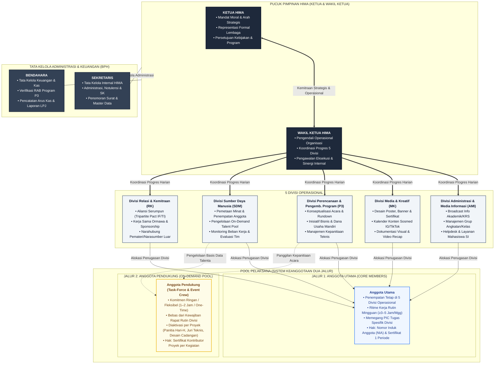
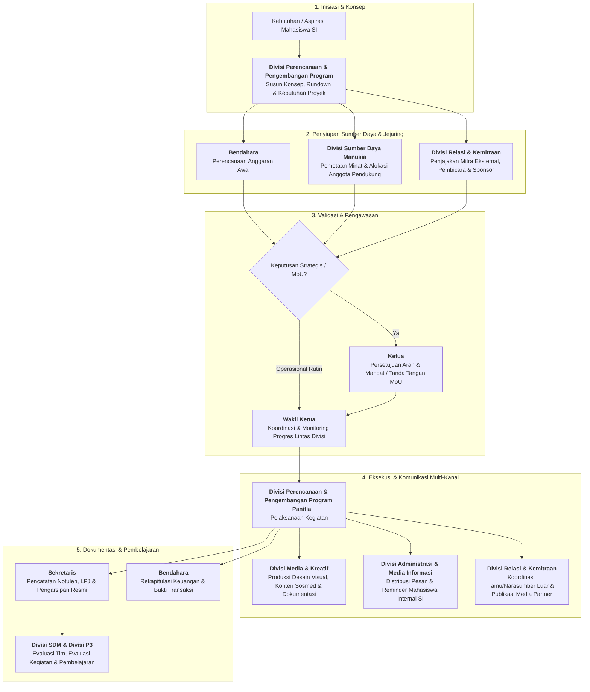

# Struktur dan Peran HIMA

## 1. Tujuan

Dokumen ini menetapkan rancangan struktur kerja HIMA yang ramping, berbasis fungsi, dan dapat dijalankan dengan kapasitas anggota yang masih berkembang.

Rancangan ini disusun untuk menjawab masalah yang teridentifikasi pada diagnosis awal: komunikasi tidak berjalan konsisten, publikasi tidak aktif, organisasi cenderung reaktif, tugas tidak memiliki pemilik yang jelas, serta anggota belum terkelola dan terlibat secara terarah.

Dokumen ini menetapkan fungsi dan batas tanggung jawab. Penempatan nama personel, jumlah anggota per divisi, dan prosedur operasional rinci ditetapkan pada dokumen terpisah.

## 2. Prinsip Struktur

- Fungsi lebih penting daripada banyaknya jabatan.
- Tidak ada fungsi kritis yang boleh kosong hanya karena belum ada divisi besar.
- Struktur harus ramping dan dapat dijalankan oleh anggota yang tersedia.
- Perangkapan fungsi diperbolehkan sementara, tetapi tanggung jawab tetap harus jelas.
- Setiap pekerjaan harus memiliki pemilik, keluaran, dan jalur eskalasi.
- Pengurus inti menjaga mandat, koordinasi, administrasi, dan keuangan.
- Divisi menjaga fungsi operasional organisasi.
- Anggota operasional ditempatkan pada divisi atau proyek berdasarkan kebutuhan, kapasitas, dan minat.
- Program tidak berdiri sebagai divisi tersendiri. Perencanaan hingga pelaksanaan program merupakan mandat Divisi Perencanaan & Pengembangan Program dengan dukungan divisi lain dan anggota operasional.

## 3. Bentuk Struktur

### Ringkasan Tingkatan Struktur:

- **Pengurus Inti (BPH)**: Ketua, Wakil Ketua, Sekretaris, Bendahara
- **Divisi Operasional (5 Divisi)**:
  - Divisi Administrasi & Media Informasi (AMI)
  - Divisi Media & Kreatif (MK)
  - Divisi Perencanaan & Pengembangan Program (P3)
  - Divisi Sumber Daya Manusia (SDM)
  - Divisi Relasi & Kemitraan (RK)
- **Pool Pelaksana (Dua Jalur Keanggotaan)**:
  - **Anggota Utama**: Penempatan divisi tetap, ritme rutin harian/mingguan (≥3 jam/minggu), memegang PIC fungsi
  - **Anggota Pendukung**: Pool on-demand / task-force, kontribusi per-proyek, insidental, atau one-time (1–2 jam/minggu atau ad-hoc)

Keempat pengurus inti bekerja sebagai satu kepengurusan.

Kepala divisi bertanggung jawab kepada Ketua dan Wakil Ketua sesuai jalur koordinasi yang ditetapkan. Anggota operasional bertanggung jawab kepada kepala divisi atau koordinator proyek yang menugaskannya.

## 4. Pengurus Inti

### Ketua

**Mandat:** Memegang arah, mandat organisasi, keputusan strategis, dan representasi formal HIMA.

**Tanggung jawab:**

- Menjaga agar kegiatan dan keputusan selaras dengan mandat HIMA.
- Mengambil keputusan strategis dan menyelesaikan isu yang tidak dapat diputuskan pada tingkat divisi.
- Menjadi representasi formal HIMA kepada Program Studi, kampus, organisasi lain, dan mitra strategis.
- Menyetujui arah program, prioritas, serta keputusan penting organisasi.
- Memastikan akuntabilitas akhir atas kinerja kepengurusan.

**Bukan mandat utama:**

- Mengerjakan seluruh tugas operasional.
- Menjadi satu-satunya penghubung komunikasi.
- Menggantikan fungsi kepala divisi.

### Wakil Ketua

**Mandat:** Menjaga koordinasi kerja, progres lintas divisi, dan tindak lanjut kepengurusan.

**Tanggung jawab:**

- Mengoordinasikan kepala divisi dan membantu menyelesaikan hambatan lintas divisi.
- Memastikan hasil rapat berubah menjadi penugasan, tenggat, dan tindak lanjut.
- Memantau progres kerja periodik serta mengeskalasi pekerjaan yang macet kepada Ketua.
- Menjadi pengganti Ketua apabila Ketua berhalangan.
- Bekerja bersama Divisi Sumber Daya Manusia untuk menjaga keterlibatan anggota.

**Bukan mandat utama:**

- Mengambil alih seluruh tugas kepala divisi.
- Menjadi satu-satunya pelaksana program.

### Sekretaris

**Mandat:** Memegang administrasi, memori organisasi, dan kebenaran dokumentasi resmi **internal HIMA**.

**Fokus Wilayah Kerja:** **Internal HIMA** (Pengurus, struktur internal, dan keanggotaan organisasi).

**Tanggung jawab:**

- Mengelola struktur kepengurusan internal, status keanggotaan aktif, dan data kontak kerja pengurus.
- Menyusun dan menyimpan notulen rapat inti/pleno, surat keputusan internal, agenda kerja, serta arsip resmi organisasi.
- Menjaga repositori terpusat (Google Drive / GitHub) agar dokumen internal organisasi terstruktur dan mudah diakses.
- Mencatat keputusan rapat, penugasan penting (_action items_), dan perubahan struktural organisasi.
- Mengelola sistem penomoran surat resmi dan persuratan formal kelembagaan (bekerja sama dengan RK untuk surat keluar eksternal).
- Mendukung kebutuhan tertib administrasi kepengurusan HIMA.

**Bukan mandat utama (Anti-Overlap):**

- Membuat desain visual atau materi publikasi (milik Divisi Media & Kreatif).
- Menjadi admin penyebar pengumuman atau pengelola grup mahasiswa Sistem Informasi (milik Divisi AMI).
- Menginisiasi negosiasi atau komunikasi diplomasi dengan pihak luar HIMA/luar SI (milik Divisi RK).

### Bendahara

**Mandat:** Memegang tata kelola keuangan dan kebenaran catatan finansial organisasi.

**Tanggung jawab:**

- Mengelola kas, anggaran, pemasukan, pengeluaran, dan bukti transaksi.
- Menyiapkan perencanaan anggaran untuk kegiatan bersama Divisi Perencanaan & Pengembangan Program dan pihak terkait.
- Menyimpan catatan keuangan serta menyusun laporan keuangan periodik.
- Memberikan informasi kondisi anggaran untuk mendukung keputusan organisasi.
- Menjaga penggunaan dana tetap dapat dipertanggungjawabkan.

**Bukan mandat utama:**

- Memutuskan sendiri prioritas program.
- Menanggung biaya tanpa persetujuan yang berlaku.

## 5. Divisi Operasional

### 5.1 Ringkasan Mandat Tiap Divisi

| Divisi                                      | Fokus Wilayah Kerja                 | Fungsi Inti                                                                                | Bentuk Kerja Nyata                                                                                                                       |
| ------------------------------------------- | ----------------------------------- | ------------------------------------------------------------------------------------------ | ---------------------------------------------------------------------------------------------------------------------------------------- |
| **Administrasi & Media Informasi (AMI)**    | **Internal Mahasiswa / Civitas SI** | Memastikan informasi akademik & kemahasiswaan sampai, jelas, dan interaktif                | Distribusi broadcast info, reminder tenggat akademik/KRS, pengelolaan kanal/grup kelas SI, helpdesk pertanyaan mahasiswa SI              |
| **Media & Kreatif (MK)**                    | Publikasi Visual HIMA               | Membentuk wajah, estetika visual, dan jejak digital publik HIMA                            | Desain sertifikat, poster, banner materi publikasi, _social media content_, dokumentasi visual, ucapan hari besar                        |
| **Perencanaan & Pengembangan Program (P3)** | Program & Eksekusi Proyek           | Mengubah ide atau kebutuhan menjadi kegiatan nyata yang terukur                            | Penyusunan konsep kegiatan, tujuan, rundown, timeline, manajemen kepanitiaan teknis, anggaran awal, dan evaluasi acara                   |
| **Sumber Daya Manusia (SDM)**               | Personel & Anggota HIMA             | Mengelola kapasitas, penempatan, dan kesehatan kerja anggota                               | _Role matching_ minat anggota, alokasi penugasan divisi/kepanitiaan, monitoring keaktifan (_workload balance_), apresiasi & evaluasi tim |
| **Relasi & Kemitraan (RK)**                 | **Eksternal SI & Eksternal HIMA**   | Menginisiasi dan mengelola kolaborasi lintas ormawa, prodi lain, kampus luar, dan industri | Penjajakan _Tripartite Pact_ (HIMA IF & TI), kolaborasi antar-himpunan, negosiasi sponsor, _media partner_, komunikasi narasumber luar   |

---

### 5.2 Divisi Administrasi & Media Informasi (AMI)

**Mandat:** Memastikan arus informasi akademik, kemahasiswaan, dan layanan organisasi sampai secara cepat, akurat, dan interaktif kepada seluruh mahasiswa Sistem Informasi UNSIA.

**Fokus Wilayah Kerja:** **Internal Mahasiswa / Civitas Sistem Informasi** (Mahasiswa aktif SI, grup angkatan, grup mata kuliah, dan perwakilan kelas SI).

**Masalah yang dijawab:** Informasi dan reminder akademik tidak berjalan konsisten sehingga mahasiswa SI tertinggal informasi penting (KRS, ujian, seminar) atau komunikasi diambil alih oleh pihak di luar HIMA tanpa validasi.

**Tanggung jawab:**

- Menyebarkan pengumuman, broadcast info akademik/prodi, reminder tenggat (KRS, pembayaran, jadwal kuliah/ujian), dan informasi kegiatan melalui kanal resmi mahasiswa SI.
- Mengelola grup atau kanal komunikasi komunitas mahasiswa SI (Grup Angkatan WhatsApp/Telegram, direktori grup kelas).
- Mengelola layanan pertanyaan/aspirasi mahasiswa SI (_helpdesk_ tanya-jawab) dan meneruskannya ke pengurus inti atau pihak prodi jika memerlukan kebijakan khusus.
- Memastikan format pesan diseminasi informasi selalu memuat tujuan, sasaran, tindakan (_call-to-action_), tenggat waktu, dan kontak penanggung jawab yang valid.
- Menjalankan follow-up informasi penting ke ketua angkatan / komti kelas SI agar tidak ada mahasiswa yang tertinggal informasi.

**Batas peran (Anti-Overlap):**

- **Bukan urusan internal pengurus HIMA:** Administrasi kepengurusan, notulensi rapat pleno, SK kepengurusan, dan master data pengurus dikelola oleh **Sekretaris**.
- **Bukan urusan pihak luar prodi/kampus:** Komunikasi dengan himpunan prodi lain, kampus luar, narasumber, atau sponsor ditangani oleh **Divisi Relasi & Kemitraan**.
- **Bukan produksi desain grafis:** Materi publikasi visual dan poster diproduksi oleh **Divisi Media & Kreatif** (AMI bertindak sebagai penyalur/distributor pesan).

### 5.3 Divisi Media & Kreatif (MK)

**Mandat:** Membentuk wajah, estetika publik, dan jejak digital HIMA melalui pengelolaan **seluruh media sosial resmi**, produksi konten kreatif, publikasi visual, serta dokumentasi media.

**Fokus Wilayah Kerja:** **Media Sosial Publik & Identitas Visual HIMA** (Instagram `@himsisfo.unsia`, TikTok, YouTube Shorts, LinkedIn, dan arsip desain).

**Masalah yang dijawab:** Akun media sosial mati/tidak aktif, citra organisasi tidak terlihat profesional, publikasi tidak menarik, dan eksistensi HIMA tidak dirasakan oleh civitas kampus maupun publik luar.

**Tanggung jawab:**

- **Pengelolaan Media Sosial Resmi HIMA:**
  - Bertindak sebagai pengelola utama (*admin/social media officer*) akun Instagram, TikTok, YouTube, dan LinkedIn resmi organisasi.
  - Menyusun dan menjalankan kalender konten berkala (*weekly content planner*) berupa tips kuliah PJJ, info teknologi, profil prodi, dan recap kegiatan.
  - Memproduksi materi konten kreatif: feed carousel, Instagram reels, video TikTok edukatif, story interaktif (polling/Q&A), dan ucapan hari besar nasional/keagamaan.
  - Membalas komentar dan interaksi publik di media sosial untuk membangun *engagement* positif.
- **Produksi Desain & Identitas Visual:**
  - Merancang seluruh aset visual resmi: poster acara, banner webinar, virtual background, template presentasi, dan sertifikat kegiatan.
  - Menjaga konsistensi identitas visual (*brand guideline*): palet warna, tipografi, dan logo organisasi.
  - Mendokumentasikan setiap acara daring/luring dalam bentuk foto, cuplikan video (*aftermovie*), dan materi publikasi.

**Batas peran (Anti-Overlap):**
- **Bukan penyebar broadcast grup chat internal:** Grup WhatsApp angkatan, grup Telegram mata kuliah, dan pengumuman teks akademik dikelola oleh **Divisi AMI** (MK memproduksi poster/link IG, AMI yang menyebarkannya ke grup WA kelas).
- **Bukan penentu substansi acara:** Konsep teknis kegiatan dan rundown disusun oleh **Divisi P3**; MK bertugas membungkusnya menjadi materi publikasi visual yang menarik.
- **Bukan negosiator media partner luar:** Kerja sama tukar publikasi (*media partner / cross-promote*) dengan organisasi luar disepakati oleh **Divisi RK**; MK bertugas mengeksekusi postingan materi di sosmed sesuai jadwal yang diberikan RK.

### 5.4 Divisi Perencanaan & Pengembangan Program (P3)

**Mandat:** Mengubah ide, kebutuhan mahasiswa, serta inisiatif bisnis/kewirausahaan organisasi menjadi program kerja nyata yang terencana dan terukur.

**Fokus Wilayah Kerja:** **Program Kerja, Inisiatif Bisnis & Kewirausahaan (Danus), dan Eksekusi Kegiatan**.

**Masalah yang dijawab:** Organisasi bergerak reaktif, kas organisasi kering karena tidak ada inisiatif dana usaha mandiri, dan kegiatan tidak terkelola secara terstruktur.

**Tanggung jawab:**

- **Pengembangan Program & Kegiatan:**
  - Memetakan kebutuhan mahasiswa SI, peluang akademik/karier, dan prioritas kegiatan.
  - Menyusun konsep kegiatan, tujuan, target sasaran, rundown, timeline, dan manajemen risiko acara.
  - Mengelola pelaksanaan teknis kegiatan atau menunjuk koordinator kepanitiaan (_project-based team_).
- **Inisiatif Bisnis & Kewirausahaan (Dana Usaha / Danus):**
  - Mengonsep dan mengelola inisiatif dana usaha mandiri organisasi (misal: merchandise resmi HIMA seperti korsa/jaket angkatan, lanyard, t-shirt, atau produk digital).
  - Mengembangkan model kegiatan bernilai tambah komersial (misal: workshop/webinar bertiket terjangkau, pelatihan bersertifikat, atau kompetisi inovasi).
  - Mengembangkan program yang sejalan dengan kurikulum prodi Sistem Informasi di bidang bisnis teknologi (misal: analisis proses bisnis, digital business showcase, atau solusi teknologi untuk UMKM).
- **Koordinasi & Evaluasi:**
  - Berkoordinasi dengan **Bendahara** terkait modal awal usaha, kalkulasi margin laba, dan pencatatan kas masuk/keluar.
  - Berkoordinasi dengan **Divisi SDM** untuk alokasi kepanitiaan acara dan tim pelaksana tugas (_Anggota Utama & Anggota Pendukung_).
  - Berkoordinasi dengan **Divisi Media & Kreatif** untuk desain produk merchandise dan materi promosi visual.
  - Berkoordinasi dengan **Divisi AMI** untuk penyebaran info pre-order atau pendaftaran acara ke mahasiswa SI.
  - Berkoordinasi dengan **Divisi Relasi & Kemitraan** jika inisiatif bisnis membutuhkan negosiasi vendor luar (konveksi/percetakan) atau mencari sponsor pendukung.
  - Mengevaluasi hasil program dan mencatat pembelajaran bersama Sekretaris.

**Batas peran (Anti-Overlap):**

- Divisi P3 memegang arah konseptual, perencanaan teknis, dan bisnis model inisiatif.
- Pengelolaan fisik uang kas, pencatatan transaksi, dan laporan laba/rugi tetap menjadi otoritas **Bendahara**.
- Penjajakan negosiasi dengan vendor pihak ketiga atau sponsor eksternal dijalankan melalui pintu **Divisi Relasi & Kemitraan**.

### 5.5 Divisi Sumber Daya Manusia

**Mandat:** Menyediakan dan mengelola orang yang menjalankan kegiatan, serta menjaga anggota tetap terlibat dan berkembang.

**Masalah yang dijawab:** Anggota dan tingkat keterlibatannya tidak jelas, pembagian tugas lemah, serta organisasi minim aksi karena personel tidak teraktivasi secara terarah.

**Tanggung jawab:**

- Bekerja bersama Sekretaris untuk menjaga daftar anggota, status keaktifan, kapasitas, minat, dan ketersediaan waktu anggota.
- Mencari dan mengidentifikasi anggota pendukung untuk kebutuhan divisi maupun kepanitiaan program kerja.
- Memetakan kemampuan dan minat anggota agar penempatan peran tepat sasaran (_role matching_).
- Membantu pembagian tugas anggota berdasarkan kebutuhan program, kapasitas, dan minat.
- Memantau keterlibatan anggota secara berkala, serta membantu mengatasi anggota yang pasif atau kewalahan (_workload balance_).
- Membantu evaluasi kontribusi dan perkembangan anggota secara periodik.
- Mendorong budaya kerja yang saling menghormati, dapat diandalkan, dan bertanggung jawab.

**Batas peran:** Divisi ini mengelola keterlibatan dan penugasan anggota. Keputusan arah program tetap berada pada Divisi Perencanaan & Pengembangan Program, sedangkan koordinasi kinerja lintas divisi berada pada Wakil Ketua.

### 5.6 Divisi Relasi & Kemitraan (RK)

**Mandat:** Menginisiasi, merawat, dan mengelola hubungan formal maupun non-formal serta kemitraan strategis dengan seluruh entitas di luar lingkup Sistem Informasi dan di luar internal HIMA.

**Fokus Wilayah Kerja:** **Eksternal SI & Eksternal HIMA** (Organisasi mahasiswa prodi lain, kampus luar, lembaga eksternal, asosiasi, industri, calon sponsor, media partner, dan narasumber luar).

**Masalah yang dijawab:**

- HIMA berjalan terisolasi tanpa sinergi dengan ormawa serumpun atau ormawa kampus lain.
- Peluang kemitraan strategis, sponsor, dan media partner terlewat karena tidak adanya penanggung jawab diplomasi eksternal.
- Negosiasi eksternal dan pencarian narasumber/pembicara sebelumnya membebani Ketua dan Wakil Ketua secara berulang.

**Tanggung jawab:**

- Menginisiasi dan menjaga forum aliansi teknologi serumpun di UNSIA (_Tripartite Pact_: HIMA Sistem Informasi, HIMA Informatika, dan HIMA Teknologi Informasi).
- Menjalin komunikasi dan peluang kolaborasi lintas disiplin dengan himpunan prodi lain (seperti Akuntansi, Manajemen, Ilmu Komunikasi) atau BEM/DPM.
- Mencari, menjajaki negosiasi, dan menyepakati kerja sama sponsorship dan media partner untuk mendukung kegiatan HIMA.
- Menjadi narahubung utama (_liaison officer_) dalam menghubungi serta mengoordinasikan narasumber/pemateri eksternal untuk program yang dirancang bersama Divisi Perencanaan & Pengembangan Program.
- Memelihara basis data jejaring kemitraan (_partnership database_), kontak narasumber, dan arsip riwayat kerja sama eksternal.

**Batas peran (Anti-Overlap):**

- **Bukan urusan internal pengurus HIMA:** Notulensi internal, tata tertib pengurus, dan arsip keanggotaan dikelola oleh **Sekretaris**.
- **Bukan urusan komunikasi mahasiswa SI:** Pengelolaan grup WhatsApp angkatan/kelas SI dan broadcast pengumuman mahasiswa SI dikelola oleh **Divisi AMI**.
- **Bukan penyusun konsep kegiatan:** Substansi teknis acara, rundown, dan anggaran dirancang oleh **Divisi P3**; Divisi RK bertugas membuka gerbang kerja sama luar, mengamankan sponsorship, dan menjembatani narasumbernya.

---

### 5.7 Matriks Anti-Overlap & Batas Kewenangan (Sekretaris vs. AMI vs. RK)

Untuk mencegah tumpang-tindih peran (_role collision_) dan kebingungan jalur komunikasi, batas kerja ketiga entitas ini diatur dengan tegas sebagai berikut:

| Dimensi                    | Sekretaris                                                                         | Divisi Administrasi & Media Informasi (AMI)                                         | Divisi Relasi & Kemitraan (RK)                                                               |
| -------------------------- | ---------------------------------------------------------------------------------- | ----------------------------------------------------------------------------------- | -------------------------------------------------------------------------------------------- |
| **Fokus Domain**           | **Internal HIMA**                                                                  | **Internal Mahasiswa / Civitas SI**                                                 | **Eksternal SI & HIMA**                                                                      |
| **Audiens Utama**          | Pengurus & anggota aktif organisasi HIMA                                           | Seluruh mahasiswa aktif prodi Sistem Informasi UNSIA                                | Pihak luar (Ormawa lain, prodi lain, kampus luar, sponsor, industri, narasumber)             |
| **Kanal Komunikasi**       | Grup koordinasi internal pengurus, drive repositori pengurus, email resmi internal | Grup WA/Telegram angkatan SI, direktori grup kelas SI, jalur broadcast civitas SI   | Email kemitraan luar, kontak perwakilan ormawa sahabat, narahubung sponsor & pembicara       |
| **Bentuk Pesan / Dokumen** | Notulen rapat, SK kepengurusan, SOP internal, database pengurus                    | Pengumuman akademik, reminder KRS/UTS/UAS, tata cara perkuliahan SI, _Q&A helpdesk_ | Proposal sponsorship, surat permohonan pembicara, MoU kerja sama, _media partner agreement_  |
| **Tugas Kunci**            | Menjaga tertib administrasi & arsip organisasi ke dalam                            | Memastikan mahasiswa SI tidak tertinggal info perkuliahan ke bawah/akar rumput      | Membuka jalan kolaborasi & jejaring organisasi ke luar                                       |
| **Penanganan Surat Resmi** | Mengeluarkan nomor surat resmi & menyimpan arsip surat masuk/keluar kelembagaan    | Menyebarkan surat edaran akademik yang relevan ke mahasiswa SI                      | Menyusun draf surat permohonan kerja sama/sponsor eksternal lalu meminta nomor ke Sekretaris |
| **Dilarang (_Don'ts_)**    | ❌ Jangan broadcast langsung ke grup mahasiswa umum SI (serahkan ke AMI).          | ❌ Jangan mengurus urusan administrasi internal rapat pengurus (tugas Sekretaris).  | ❌ Jangan mengelola broadcast grup kelas SI atau grup internal pengurus HIMA.                |
|                            | ❌ Jangan bernegosiasi mandiri dengan sponsor/mitra luar (serahkan ke RK).         | ❌ Jangan menghubungi pihak luar/sponsor secara sepihak (serahkan ke RK).           | ❌ Jangan mengeluarkan surat resmi tanpa penomoran dan arsip dari Sekretaris.                |

---

## 6. Anggota Operasional (Sistem Keanggotaan Dua Jalur)

Mengingat demografi mahasiswa UNSIA yang didominasi mahasiswa pekerja, berwirausaha, atau memiliki tanggungan keluarga, ketersediaan waktu tiap individu sangat bervariasi. Berdasarkan hasil screening pendaftar, terdapat anggota dengan komitmen waktu konsisten (≥3–5 jam/minggu), namun ada pula yang hanya sanggup berkontribusi minimal (1–2 jam/minggu) atau bersedia membantu pada momentum tertentu (_one-time / event-based_).

Untuk mencegah fenomena _drop-out_ atau _ghosting_ akibat beban kerja yang dipaksakan sama rata, keanggotaan operasional dibagi ke dalam **dua jalur fleksibel**:

---

### 6.1 Anggota Utama (_Core Operational Members_)

**Mandat:** Menjadi tulang punggung operasional divisi yang menjaga ritme kerja harian dan mingguan organisasi berjalan stabil.

**Karakteristik & Profil:**

- Memiliki alokasi waktu luang yang konsisten (rata-rata ≥3–5 jam per minggu).
- Siap berkomitmen penuh selama minimal 1 semester kepengurusan.

**Penempatan & Peran:**

- Ditempatkan secara definitif pada salah satu dari 5 Divisi Operasional (AMI, MK, P3, SDM, atau RK).
- Memegang PIC (_Person in Charge_) fungsi spesifik di divisinya (misal: PIC Kalender Konten di MK, PIC Helpdesk Mahasiswa di AMI, atau PIC Kemitraan di RK).
- Mengikuti rapat koordinasi berkala divisi dan pelaporan progres mingguan.

**Hak & Benefit Organisasi:**

- Penerbitan Nomor Induk Anggota (NIA) resmi HIMA Sistem Informasi.
- Sertifikat Pengurus / Anggota Utama 1 Periode Penuh dengan rincian portofolio jabatan.
- Hak prioritas untuk dipromosikan menjadi Kepala Divisi atau Pengurus Inti pada periode berikutnya.
- Akses penuh ke repositori arsip dan ekosistem kerja internal HIMA.

---

### 6.2 Anggota Pendukung (_Supporting / On-Demand / One-Time Contributors_)

**Mandat:** Menyediakan tenaga pendukung terfokus pada kepanitiaan acara khusus, tugas insidental, atau proyek berbatas waktu (_time-boxed project_) tanpa terbebani rutinitas harian.

**Karakteristik & Profil:**

- Mahasiswa pekerja dengan jam kerja padat/shift yang hanya memiliki waktu 1–2 jam per minggu, hanya aktif di akhir pekan, atau memilih kontribusi _one-time_.
- Mahasiswa yang ingin tetap memiliki rasa keterikatan (_belonging_) dengan himpunan dan ingin membantu teman sekelas, tetapi takut terbebani birokrasi organisasi.

**Model Kerja (On-Demand Talent Pool):**

- Tidak ditempatkan di divisi harian dan **tidak diwajibkan mengikuti rapat mingguan divisi**.
- Terdaftar dalam basis data talenta (_talent pool_) yang dikelola oleh **Divisi Sumber Daya Manusia (SDM)**.
- **Diaktivasi per proyek atau per penugasan spesifik**, contohnya:
  1. **Kepanitiaan Hari-H Acara (_Event Crew_)**: Menjadi operator Zoom, timekeeper, moderator, MC, atau presensi pada acara webinar/lomba (seperti _HIMSISFO Web Innovation Challenge_).
  2. **Bantuan Keterampilan Lepas (_Ad-hoc Skill_)**: Pembuatan 1 desain poster tambahan saat desainer MK kewalahan, _code review_ website, pengisi suara/video pendek, atau pengolahan data spreadsheet.
  3. **Penyambung Lidah Kelas (_Class Pulse_)**: Membantu AMI mengidentifikasi keluhan atau isu akademik yang terjadi di grup kelas masing-masing.

**Hak & Benefit Organisasi:**

- Sertifikat Kontributor Proyek / Kepanitiaan Resmi (_Project-Based Certificate_) per kegiatan yang diselesaikan.
- Bebas dari rasa bersalah atau intimidasi absensi karena beban kerja disesuaikan sejak awal.
- Portofolio nyata hasil karya yang dapat dicantumkan pada resume/LinkedIn.
- **Jalur Upgrade Fleksibel**: Dapat mengajukan diri untuk beralih status menjadi Anggota Utama di semester berikutnya apabila beban kerja pribadinya sudah lebih longgar.

---

### 6.3 Matriks Perbandingan Dua Jalur Keanggotaan

| Parameter              | Anggota Utama                                         | Anggota Pendukung                                                  |
| ---------------------- | ----------------------------------------------------- | ------------------------------------------------------------------ |
| **Ekspektasi Waktu**   | Rutin ≥3–5 jam / minggu                               | Fleksibel 1–2 jam / minggu atau insidental (_one-time_)            |
| **Bentuk Keterikatan** | Penempatan divisi tetap (AMI, MK, P3, SDM, RK)        | Masuk _On-Demand Talent Pool_ (dibina Divisi SDM)                  |
| **Kewajiban Rapat**    | Wajib hadir koordinasi periodik divisi                | Bebas dari rapat rutin (hanya briefing teknis proyek yang diambil) |
| **Beban Tugas**        | Menjaga tugas berkelanjutan & fungsi divisi           | Berbasis paket tugas tuntas (_task-based_ / _event-based_)         |
| **Hak Sertifikat**     | Sertifikat Anggota Aktif Kepengurusan 1 Periode Penuh | Sertifikat Kontributor Proyek / Panitia per Kegiatan               |
| **Tingkat Tekanan**    | Moderat (memiliki target operasional divisi)          | Rendah (tidak ada tuntutan operasional rutin)                      |
| **Manajemen PIC**      | Kepala Divisi terkait & Wakil Ketua                   | Koordinator Proyek Acara & Divisi SDM                              |

---

### 6.4 Mekanisme Aktivasi & Rotasi Anggota

1. **Pemetaan Awal**: Divisi SDM memetakan preferensi kapasitas pendaftar dari data screening (waktu luang, keterampilan spesifik, dan ketersediaan hari).
2. **Katalog Proyek Terbuka**: Ketika Divisi P3 merancang kegiatan, Divisi SDM mengumumkan kebutuhan kepanitiaan/tugas mikro kepada pool Anggota Pendukung (_call for task volunteers_).
3. **Pemberian Tugas Berbatas Jelas**: Anggota pendukung yang bersedia mengambil tugas diberikan instruksi yang jelas dengan batas waktu (_deadline_) realistis dan PIC pendamping.
4. **Evaluasi & Apresiasi**: Begitu tugas selesai, Divisi SDM langsung mencatat rekam kontribusi dan menerbitkan sertifikat/apresiasi tanpa menahan mereka dalam birokrasi lanjutan.
5. **Transisi Status**: Anggota Utama yang mengalami lonjakan beban kerja pribadi dapat mengajukan permohonan transisi sementara menjadi Anggota Pendukung (_cooldown_), dan sebaliknya Anggota Pendukung yang ingin lebih aktif dapat diangkat menjadi Anggota Utama.

## 7. Alur Kerja Lintas Fungsi

1. **Divisi Perencanaan & Pengembangan Program** mengidentifikasi kebutuhan dan menyusun rancangan konsep, rundown, dan anggaran awal kegiatan.
2. **Divisi Sumber Daya Manusia** memetakan anggota pendukung dan membagi tugas personel sesuai minat dan kapasitas.
3. **Divisi Relasi & Kemitraan** menjajaki narasumber eksternal, sponsor, dan mitra kolaborasi jika program membutuhkan kehadiran pihak luar.
4. **Bendahara** memverifikasi kelayakan anggaran dan alokasi kas kegiatan.
5. **Divisi Media & Kreatif** menyiapkan seluruh aset visual (poster, virtual background, banner, sertifikat).
6. **Divisi Administrasi & Media Informasi** mendistribusikan publikasi dan reminder secara berkala ke grup-grup angkatan mahasiswa Sistem Informasi.
7. **Divisi Relasi & Kemitraan** mendistribusikan materi promosi ke jaringan ormawa eksternal dan media partner, serta mendampingi narasumber/tamu eksternal.
8. **Sekretaris** mencatat notulensi evaluasi, mengelola administrasi LPJ, dan mengarsipkan dokumen secara terpusat.
9. **Wakil Ketua** memantau progres harian lintas 5 divisi operasional dan mengurai hambatan kerja.
10. **Ketua** memberikan arahan strategis, validasi mandat resmi, dan menandatangani kerja sama kelembagaan/MoU.

## 8. Ketentuan Kapasitas dan Perangkapan

- Struktur ini menetapkan fungsi operasional berbasis 5 divisi, bukan kewajiban untuk langsung memiliki struktur gemuk.
- Jika SDM terbatas, satu pengurus dapat memegang perangkapan fungsi secara transparan dengan batas kapasitas kerja yang disepakati.
- Perangkapan yang paling mungkin pada fase perintisan:
  - Divisi Administrasi & Media Informasi (AMI) dapat berkolaborasi erat dengan Divisi Media & Kreatif (MK).
  - Wakil Ketua dapat mendampingi fungsi Divisi Relasi & Kemitraan (RK) atau Divisi SDM sampai terdapat penanggung jawab divisi definitif.
- **Prinsip Anti-Overlap Wajib Dipatuhi:**
  - Sekretaris menjaga ranah **Internal HIMA**.
  - AMI memegang kanal **Internal Mahasiswa SI**.
  - RK memegang diplomasi **Eksternal SI & HIMA**.
  - Ketiga fungsi ini tidak boleh saling mencampuri kanal atau mengambil alih wewenang tanpa koordinasi.
- Pekerjaan yang tidak mampu ditangani harus dieskalasi, disederhanakan, atau dijadwalkan ulang secara terbuka.

